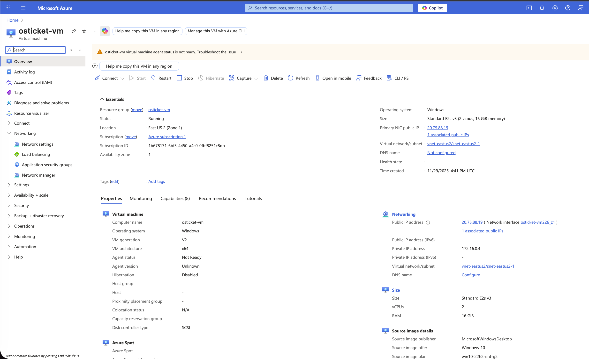
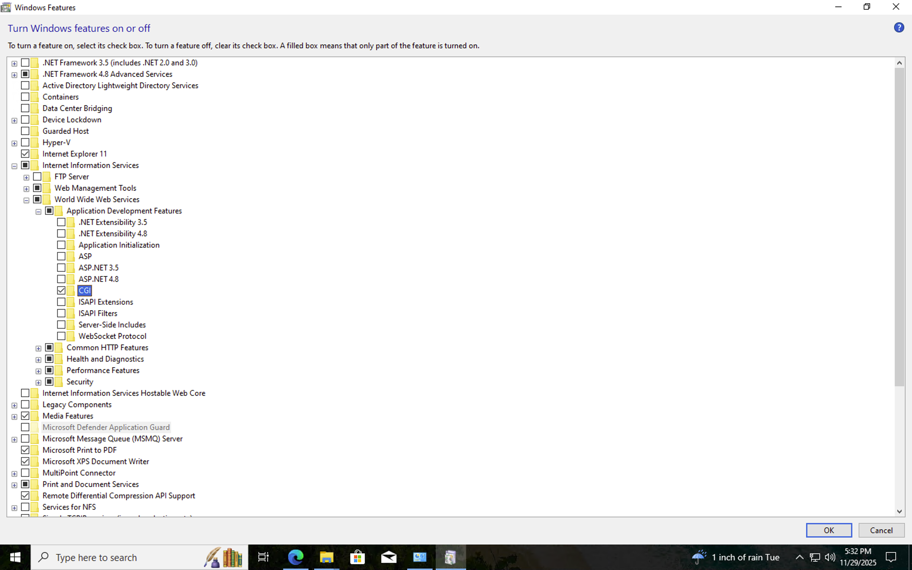
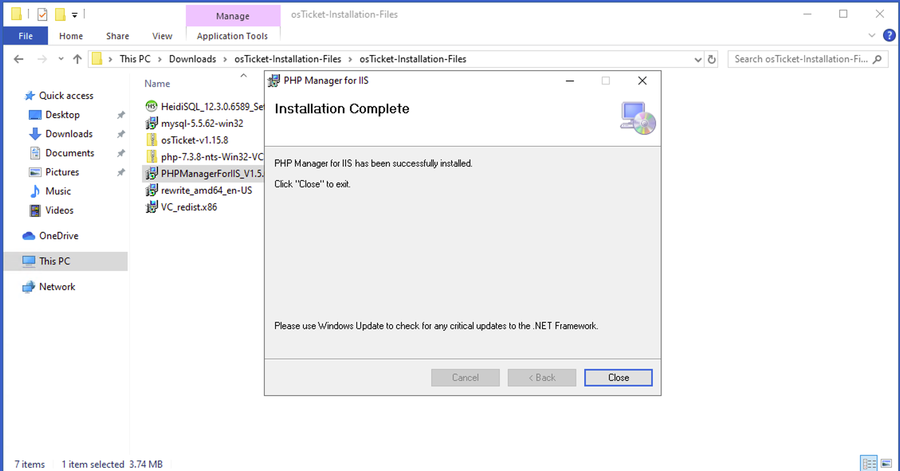
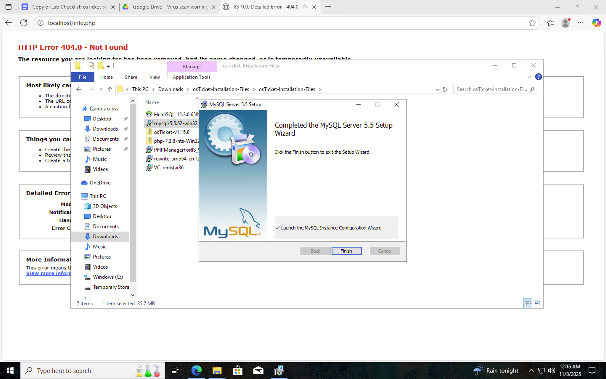
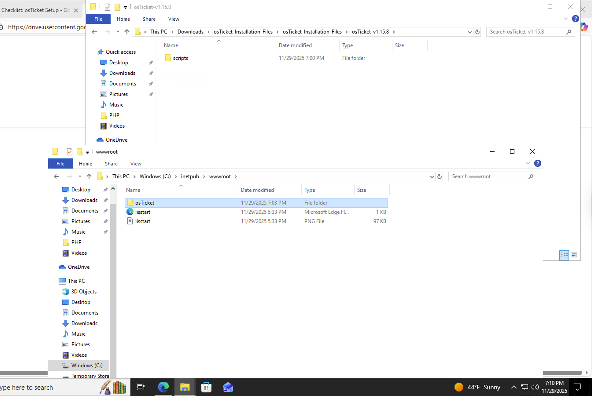
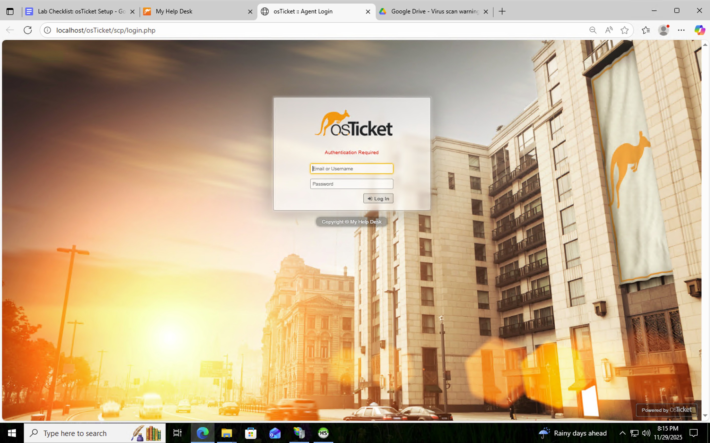

# osTicket Help Desk Lab — Installation and Prerequisites

> **Portfolio lab:** Personal training environment; not a production system.

## Overview

The first stage of a three-part help desk lab: provisioning a Windows 10 virtual machine in Azure and installing the IIS, PHP, and MySQL prerequisites for osTicket.

## Tools and technologies

Microsoft Azure, Windows 10, IIS, PHP, MySQL, osTicket, RDP

## What I did

1. Create the Windows VM in Azure and configure access for the lab.
2. Install and enable IIS and supporting PHP/MySQL components.
3. Deploy and configure osTicket, then verify the application is accessible.
4. Continue with agent, department, and workflow configuration in the next repository.

## Selected evidence

### VM and web server

### Application prerequisites

### Installation

## What I learned

Installing a ticketing platform provided practice with application dependencies, Windows services, and the setup tasks that precede support operations.

## Related work

[Installation](https://github.com/lukasparmelee/osTicket-prereqs) · [Post-install configuration](https://github.com/lukasparmelee/post-install-config) · [Ticket lifecycle](https://github.com/lukasparmelee/Ticket-lifecycle)

## Security and scope

Screenshots and instructions describe a controlled learning lab. Do not reuse demonstration credentials, expose live secrets, or reproduce permissive firewall settings in production. Verify screenshots and repository history contain no active credentials before publishing.

