# osTicket Help Desk Deployment — Azure, IIS, PHP & MySQL

> **Hands-on IT support lab** · Retired training environment, not a production deployment.

## Project overview

Deployed a Windows 10 virtual machine in Microsoft Azure and configured the components required to run an osTicket help desk: Internet Information Services (IIS), PHP, MySQL, and osTicket. This repository documents the original installation process, including configuration screens and verification steps.

**Skills demonstrated:** Windows administration, cloud VM provisioning, IIS setup, PHP configuration, MySQL database setup, troubleshooting, and technical documentation.

**Environment:** Azure Windows 10 VM; osTicket v1.15.8; PHP 7.3.8; MySQL 5.5.62 (versions used in the historical lab, **not recommended for new production deployments**).

### Lab outcome

The installation produced a locally accessible osTicket help desk with an agent interface and end-user portal. The Azure VMs have since been deleted.

### Documentation

The complete original walkthrough follows. Screenshots remain referenced by their original repository filenames. These are **historical lab steps**, not a hardened production installation guide.

---

## Original implementation walkthrough

# osTicket Windows 10 VM Setup Guide

## Goal

Create a Windows 10 VM to host osTicket and supporting software (IIS, PHP, MySQL).

---

# Step 1 — Create the Windows 10 VM (Azure Portal)

## Exact Steps and UI Paths

1. Azure Portal → **Create a resource** → **Compute** → **Virtual machine**

### Basics Tab

- Subscription: `AZURE subscription 1`
- Resource group: `osticket-vm` (create new)
- Virtual machine name: `osticket-vm`
- Region: `East US 2`
- Image: `Windows 10 Enterprise - 22H2`
- Size: `Standard_E2s_v3`
- Administrator account: `labuser`

[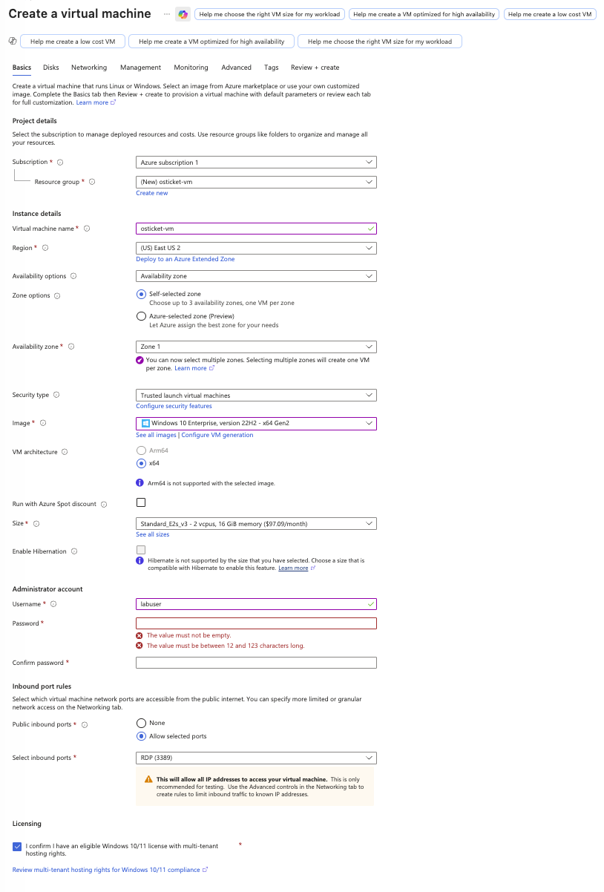](basics.png)

---

### Disks Tab

- OS disk type: `Premium SSD`
- Data disk: none added for this lab

[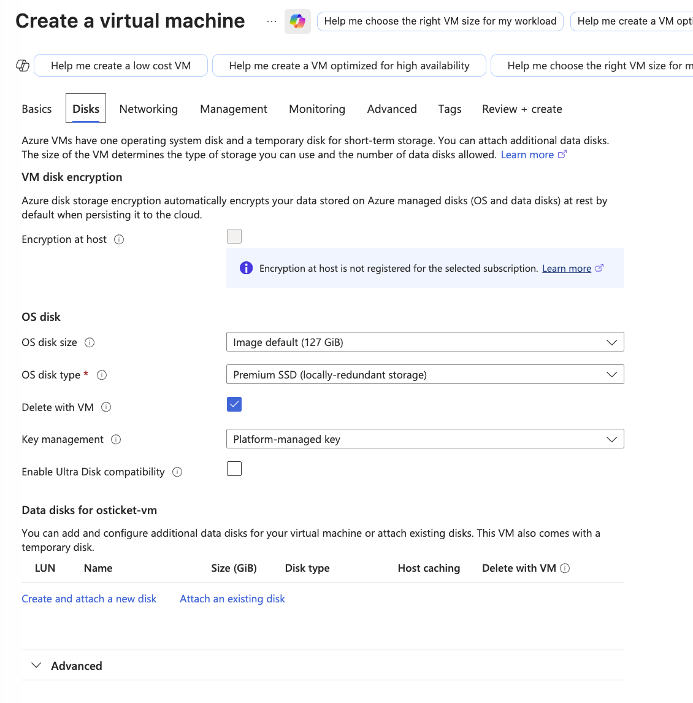](disks.png)

---

### Networking Tab

- Virtual network: `vnet-eastus2(osticket-vm)` (create new)
- Subnet: `default`
- Public inbound ports: **RDP (3389)** — restricted to your public IP address `X.X.X.X/32`

[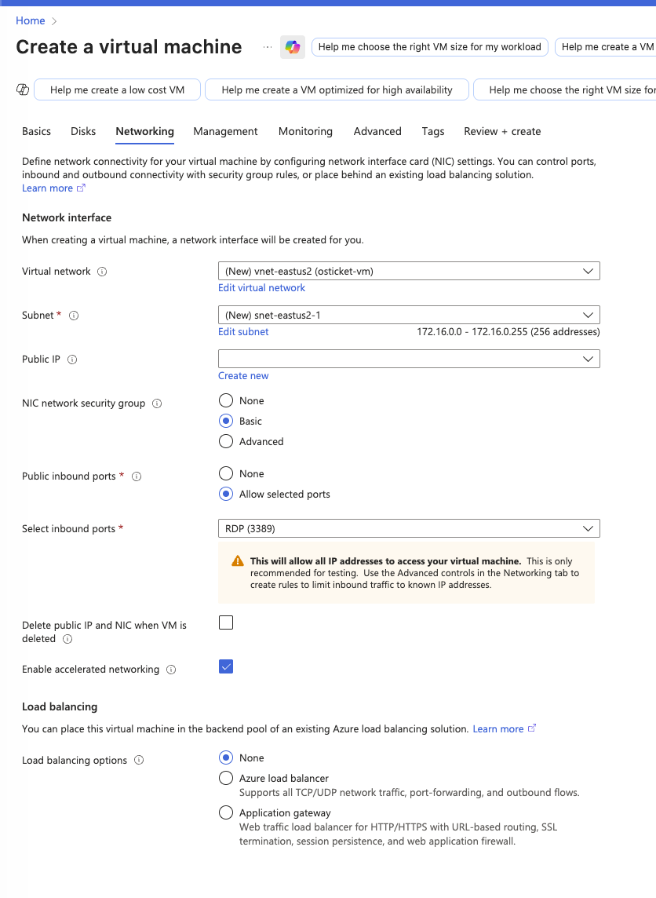](networks.png)

---

4. Review + Create → Confirm the validation passed → **Create**

---

## After Deployment

1. Open the VM **Overview** page
2. Verify:
   - Public IP address
   - Status = **Running**

[](overview.png)

---

## Connect via RDP

1. Download the RDP file
2. Open Microsoft Remote Desktop
3. Click the `+` button
4. Select **Add PC**
5. Enter the public IP address
6. Click **Add**
7. Log in using:
   - Username: `labuser`
   - Password: `Cyberlab123!`

[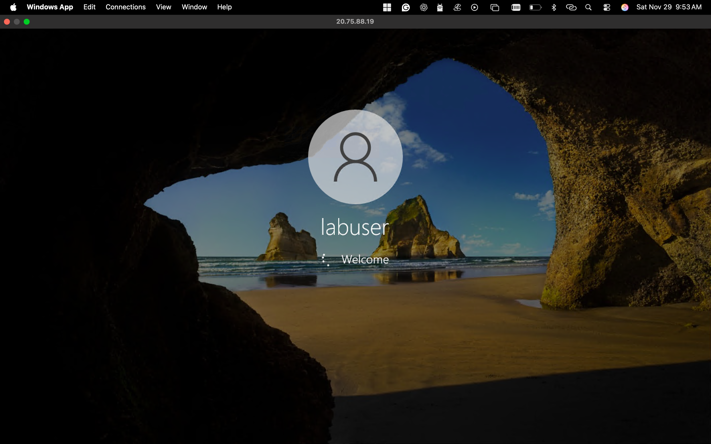](connection.png)

---

# Step 2 — Configuring osTicket

## Download and Extract Installation Files

1. Within the VM download:

   - `osTicket-Installation-Files.zip`
2. Right click the ZIP file
3. Select **Extract All**
4. Click **Extract**

[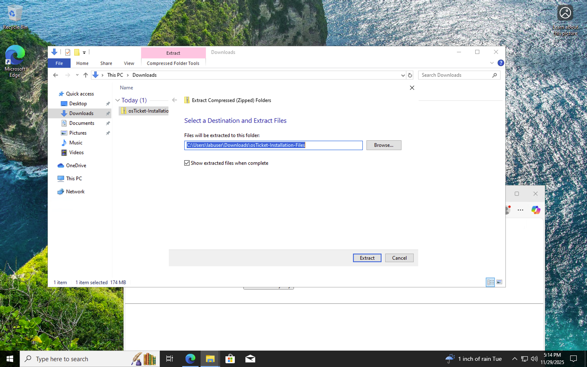](zip.png)

---

## Enable IIS

1. Open **Control Panel**
2. Under Programs click:
   - **Uninstall a program**
3. On the left side click:
   - **Turn Windows features on or off**
4. Find:
   - `Internet Information Services`
5. Expand:
   - `World Wide Web Services`
6. Expand:
   - `Application Development Features`
7. Enable all required features
8. Click **OK**

[](IIS.png)

---

# Step 3 — Install PHP Manager

## Install PHP Manager for IIS

1. Open the `osTicket-Installation-Files` folder
2. Double click:
   - `PHPManagerForIIS_V1.5.0`
3. Click:
   - Next
   - I Agree
4. Finish installation

[](PHP.png)

---

## Install URL Rewrite Module

1. Double click:
   - `rewrite_amd64_en-US`
2. Accept the terms
3. Click **Install**

[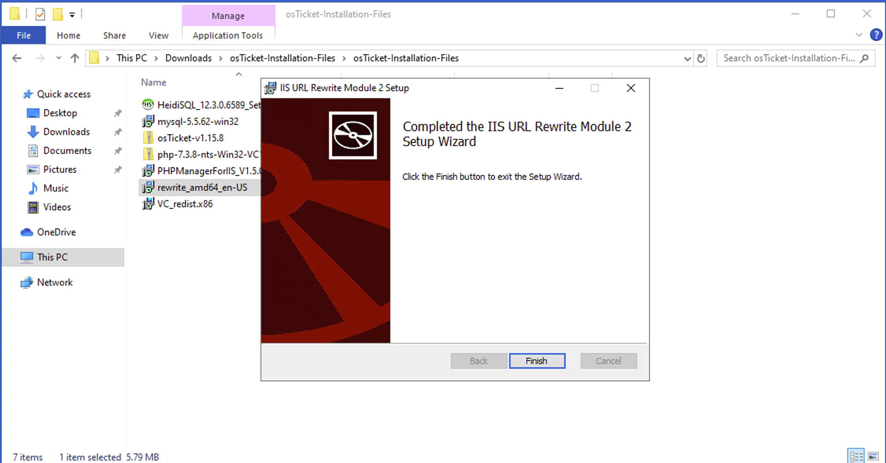](rewrite.png)

---

# Step 4 — Create the `C:\PHP` Directory

1. Open the `C:` drive
2. Create a folder named:

   - `PHP`
3. In `osTicket-Installation-Files` locate:

   - `php-7.3.8-nts-Win32-VC15-x86`
4. Right click the ZIP file
5. Select **Extract All**
6. Browse to:

   - `C:\PHP`
7. Extract the files

[](PHP.png)

---

# Step 5 — Install VC++ Redistributable

1. Double click:
   - `VC_redist.x86`
2. Accept the terms
3. Click **Install**

[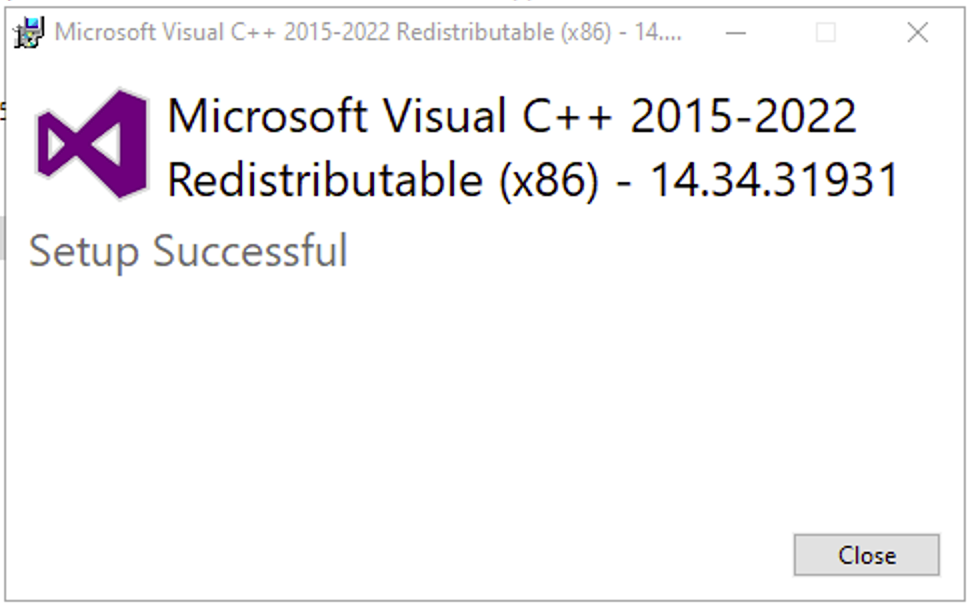](VC.png)

---

# Step 6 — Install MySQL

1. Double click:

   - `mysql-5.5.62-win32`
2. Click:

   - Next
   - Accept License Agreement
   - Next
3. Select:

   - `Typical` setup
4. Click:

   - Next
   - Install
5. Enable:

   - `Launch the MySQL Instance Configuration Wizard`
6. Click **Finish**

---

# Step 7 — Configure MySQL

1. Click **Next**
2. Select:

   - `Standard Configuration`
3. Click **Next**
4. Set the root password:

   - Username: `root`
   - Password: `root`
5. Click:

   - Next
   - Execute

[](sql.png)

---

# Step 8 — Register PHP Within IIS

1. Open IIS as Administrator

   - Search for `IIS`
   - Right click
   - Select **Run as administrator**
2. Double click:

   - `PHP Manager`
3. Select:

   - `Register new PHP version`
4. Click the `...` browse button
5. Navigate to:

   - `C:\PHP`
6. Select:

   - `php-cgi.exe`
7. Click:

   - Open
   - OK

---

# Step 9 — Reload IIS

1. In IIS Manager:

   - Right click `osticket-vm`
   - Click **Stop**
2. Right click again
3. Click **Start**

[](IIS.png)

---

# Step 10 — Install osTicket

1. Open:

   - `osTicket-v1.15.8`
2. Right click the ZIP file
3. Select:

   - **Extract All**
4. Inside the extracted folder locate:

   - `upload`
5. Copy the `upload` folder to:

   - `C:\inetpub\wwwroot`
6. Rename:

   - `upload` → `osTicket`

---

# Step 11 — Reload IIS Again

1. Open IIS as Administrator
2. Stop and Start the server again
3. Expand:

   - `osticket-vm`
   - `Default Web Site`
4. Right click:

   - `Browse *:80 (http)`

[](Reload.png)

---

## Verify osTicket Installer Page

You should now see the osTicket installer page.

[](page.png)

---

# Step 12 — IIS Configurations

1. In IIS:

   - Navigate to:
     - `Sites → Default Web Site → osTicket`
2. Double click:

   - `PHP Manager`
3. Under PHP Extensions select:

   - `Enable or disable an extension`
4. Enable:

   - `php_imap.dll`
   - `php_intl.dll`
   - `php_opcache.dll`
5. Refresh the osTicket webpage

[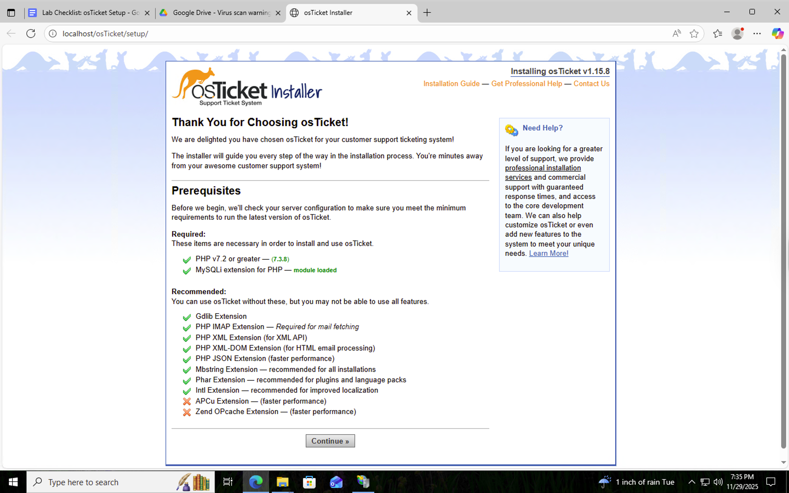](refresh.png)

---

# Step 13 — Rename `ost-config.php` and Assign Permissions

## Rename Configuration File

Rename:

```
C:\inetpub\wwwroot\osTicket\include\ost-sampleconfig.php
```

To:

```
C:\inetpub\wwwroot\osTicket\include\ost-config.php
```

---

## Assign Permissions

1. Right click:
   - `ost-config.php`
2. Open:
   - Properties → Security → Advanced
3. Click:
   - Disable inheritance
4. Select:
   - Remove all inherited permissions
5. Click:
   - Add
6. Add:
   - `Everyone`
7. Enable all basic permissions
8. Click:
   - Apply
   - OK

[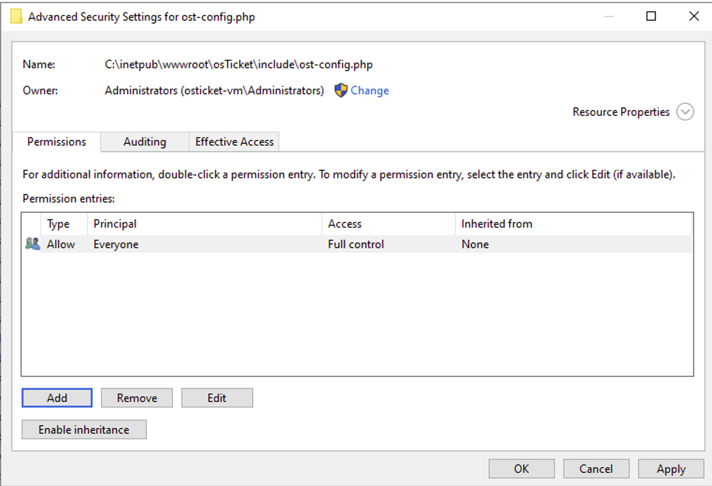](config.png)

---

# Step 14 — Install HeidiSQL

1. Install HeidiSQL
2. Click:
   - Next
   - Install
   - Finish

---

## Create Database

1. Open HeidiSQL
2. Click:

   - New
3. Enter:

   - User: `root`
   - Password: `root`
4. Click:

   - Open
5. Right click:

   - `Unnamed`
6. Select:

   - Create New → Database
7. Database Name:

   - `osTicket`

[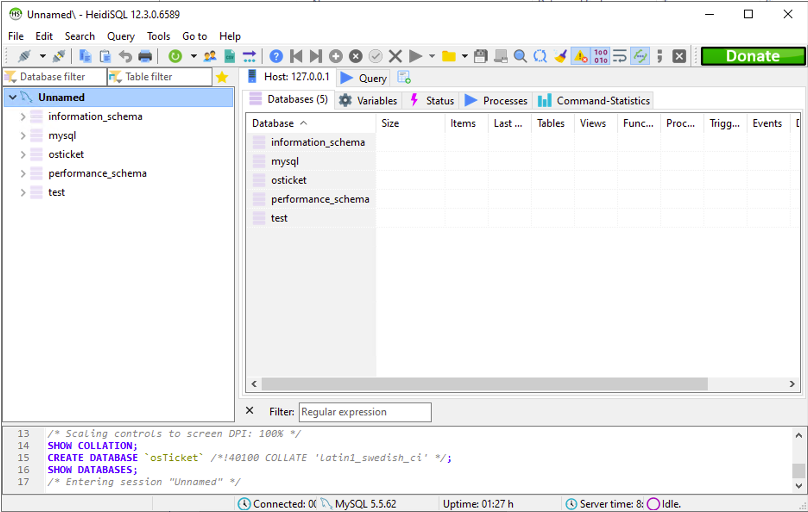](heidi.png)

---

# Step 15 — Configure osTicket in Browser

1. Return to the osTicket installer
2. Click:
   - Continue

---

## Help Desk Settings

- Help Desk Name:

  - `My Help Desk`
- Email:

  - `lukasemail@gmail.com`

---

## Admin Account

- Username:

  - `adminuser`
- Password:

  - `Password1`

---

## Database Settings

- MySQL Database:

  - `osTicket`
- MySQL Username:

  - `root`
- MySQL Password:

  - `root`

---

3. Click:
   - **Install Now**

[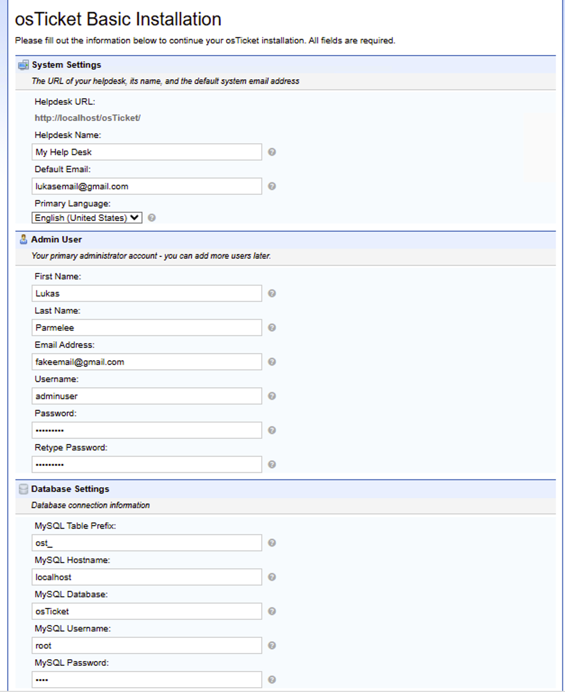](basic.png)

---

# Step 16 — Access osTicket

## Agent Login Page

```
http://localhost/osTicket/
```

[](admin.png)

---

## End User Portal

```
http://localhost/osTicket/
```

[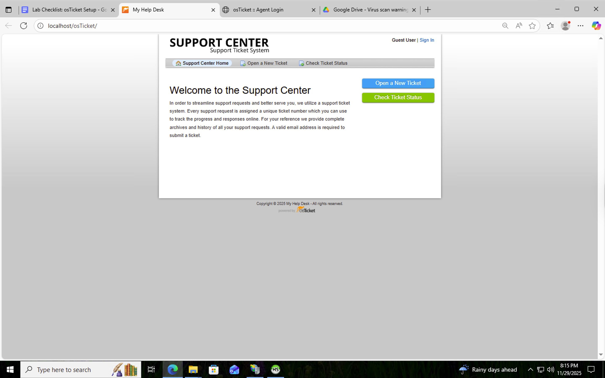](enduser.png)

---

## Security and production considerations

- **Do not copy the lab's temporary permissions into production.** In particular, granting `Everyone` broad access to `ost-config.php` was a lab installation step, not an appropriate long-term configuration. Restrict permissions after setup according to current osTicket guidance.
- The original lab used demonstration passwords and allowed an RDP connection limited to a specified source IP. The VM was subsequently deleted. Never reuse demonstration passwords, and avoid exposing RDP directly on production systems.
- The software versions above are historical and may be unsupported. For a new deployment, follow current vendor documentation and supported versions.
- This repository documents personal training work; it does not claim production administration experience.

## Related projects

- [osTicket post-installation configuration](https://github.com/lukasparmelee/post-install-config)
- [osTicket ticket lifecycle](https://github.com/lukasparmelee/Ticket-lifecycle)
- [GitHub portfolio](https://github.com/lukasparmelee)

